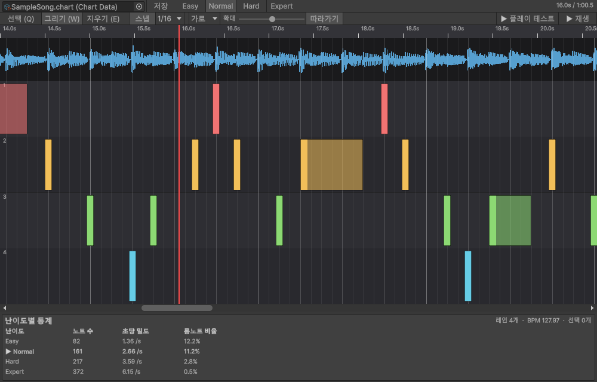
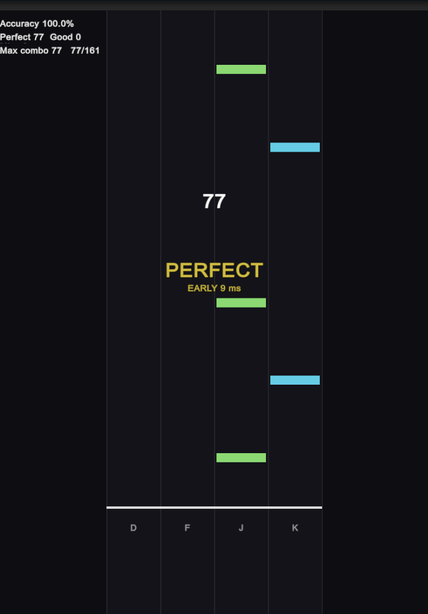

# Rhythm Chart Tool

mp3 같은 오디오를 Python(librosa)으로 분석해 BPM·박자·타격 시점(onset)을 뽑고, **난이도 4단계(Easy/Normal/Hard/Expert) 노트를 자동으로 만든 뒤**, Unity 에디터 안에서 파형을 보며 고치고 저장하는 리듬게임 차트 제작 도구입니다.
다른 Unity 프로젝트에서 Git URL 로 설치해 재사용할 수 있고, 만든 차트를 바로 쳐 볼 수 있는 최소 재생 코드와 샘플이 들어 있습니다.



| 기능 | 설명 |
|---|---|
| 분석 | 오디오 선택 → 메뉴 한 번. 비동기로 실행되며 진행률 표시와 취소를 지원합니다. |
| 난이도 자동 생성 | 분석 데이터에서 C# 으로 즉시 생성합니다(Python 재실행 없음). 같은 시드는 항상 같은 결과. |
| 차트 에디터 | 파형, 비트 그리드, 스냅, 노트 추가/삭제/이동/롱노트, 다중 선택, 미리듣기, Undo/Redo, 난이도별 통계. 가로/세로 타임라인. |
| 재생 | `AudioSettings.dspTime` 기준 `ChartPlayer`, Perfect/Good/Miss 판정, 에디터의 "플레이 테스트", 샘플 씬. |
| 차트 JSON | `schemaVersion` 과 마이그레이션 훅이 있는 입출력. 런타임에서도 읽을 수 있습니다. |

> **상태: 0.1.0 (초기 버전).** 아래 [알려진 한계](#알려진-한계)를 꼭 읽어 보세요. 특히 Unity 2022.3 호환과 macOS/Linux 는 아직 확인하지 못했습니다.

---

## 요구 사항

- **Unity 6000.3 (검증됨)**. 목표는 2022.3 LTS 이상이지만 2022.3 은 확인하지 못했습니다.
- **Python 3.12 이상.** 고정한 librosa 1.0.0 / numpy / scipy 가 요구하는 버전이며 3.13 에서만 실행해 보았습니다.
- **Input System 패키지**(`com.unity.inputsystem`). 패키지 의존성이라 자동으로 설치됩니다. 샘플 씬과 플레이 테스트의 키 입력에 쓰입니다. 구 Input Manager 만 쓰는 프로젝트는 `Player Settings > Active Input Handling` 을 `Input System Package (New)` 또는 `Both` 로 바꿔야 키가 들어옵니다.
- 인터넷(처음 한 번 Python 패키지를 내려받습니다). ffmpeg 는 필요 없습니다.

## 설치

**Package Manager** → `+` → `Add package from git URL...` 에 아래를 넣습니다.

```
https://github.com/sum-in2/rhythm-chart-tool.git?path=/Packages-src/com.sumin.rhythm-chart-tool#v0.1.0
```

또는 프로젝트의 `Packages/manifest.json` 의 `dependencies` 에 직접 추가합니다.

```json
"com.sumin.rhythm-chart-tool": "https://github.com/sum-in2/rhythm-chart-tool.git?path=/Packages-src/com.sumin.rhythm-chart-tool#v0.1.0"
```

- `#v0.1.0` 은 Git 태그입니다. 태그를 만들기 전에는 `#main` 을 쓰세요.
- 저장소가 **비공개**이면 Unity 가 호출하는 시스템 `git` 에 인증이 되어 있어야 합니다(자격 증명 관리자 또는 SSH). SSH 주소는 `ssh://git@github.com/sum-in2/rhythm-chart-tool.git?path=/Packages-src/com.sumin.rhythm-chart-tool#v0.1.0` 형태입니다. 이 설치 경로는 아직 실제로 시험하지 못했습니다.
- 개발용으로 로컬 폴더를 직접 참조하려면 `"com.sumin.rhythm-chart-tool": "file:/절대/경로/Packages-src/com.sumin.rhythm-chart-tool"` 처럼 씁니다(이 저장소의 `TestProject` 가 이 방식을 씁니다).

## 빠른 시작

1. **Python 환경 설정.** `Tools > Rhythm Chart > Settings...` 를 열고 `Python 환경 설정` 버튼을 누릅니다. venv 를 만들고 패키지를 설치하는 데 몇 분 걸립니다(자세한 내용은 아래).
2. **분석.** 프로젝트 창에서 오디오(AudioClip)를 선택하고 `Tools > Rhythm Chart > Analyze Selected Audio`(또는 우클릭 `Rhythm Chart > Analyze Selected Audio`)를 실행합니다.
3. 오디오 옆에 `<이름>.chart.asset` 이 생기고, **4개 난이도 노트가 자동으로 만들어져 있습니다.**
4. 차트 에셋을 **더블클릭**하면 차트 에디터가 열립니다. 노트를 고치고 `저장` 을 누릅니다.
5. 에디터 툴바의 `▶ 플레이 테스트` 를 누르면 현재 위치부터 Game 뷰에서 `D F J K` 로 직접 쳐 볼 수 있습니다.

환경이 없는 상태에서 분석을 실행하면 "지금 설정할까요?" 확인창이 뜨고, 수락하면 설정이 끝난 뒤 분석이 이어집니다.

---

## Python 환경 설정

`Tools > Rhythm Chart > Settings...`

| 항목 | 설명 |
|---|---|
| Python 실행 파일 | venv 를 만들 때 쓰는 시스템 Python. 비워 두면 PATH 에서 `python3`, `python`, `py -3` 순으로 찾고, 찾으면 그 경로를 저장합니다. Windows 스토어의 가짜 `python3` 는 걸러집니다. 컴퓨터 전체에서 공유되는 설정(EditorPrefs)입니다. |
| 가상환경(venv) 경로 | 기본은 `<프로젝트>/Library/RhythmChartTool/venv`. 프로젝트마다 따로 저장됩니다. |
| `Python 환경 설정` 버튼 | `python -m venv` 후 패키지 안 `Python~/requirements.txt` 를 `pip install` 합니다. 진행 로그를 창에 보여 주고 취소할 수 있습니다. |

- 설치가 끝나면 venv 에 완료 표시(`rhythmchart-env.json`, requirements 의 해시)를 남깁니다. **패키지를 업데이트해서 `requirements.txt` 가 달라지면** 상태가 "오래됨"으로 바뀌고 분석 전에 다시 설정할지 묻습니다.
- 기본 venv 가 `Library` 아래라서 `Library` 폴더를 지우면 환경도 사라집니다. 분석 전에 확인창이 뜨므로 다시 설정하면 됩니다(자동으로 설치하지는 않습니다).
- 분석 결과 JSON 은 `Library/RhythmChartTool/analysis/` 에 잠깐 만들어지고 가져온 뒤 지워집니다.
- 한글/공백이 들어간 경로도 동작합니다(인자는 인자 목록으로 넘기고 Python 입출력은 UTF-8 로 고정).

## 분석과 차트 에셋

- 분석은 별도 프로세스(Python)로 비동기 실행됩니다. 진행률 표시줄의 취소 버튼을 누르면 하위 프로세스까지 종료됩니다.
- 실패하면 Python 의 stderr 가 Console 에 에러로 출력됩니다. 성공했는데 stderr 가 있으면(라이브러리 경고) 일반 로그로 남깁니다.
- 이미 `<이름>.chart.asset` 이 있으면 덮어쓸지 묻습니다. **재분석은 분석 데이터(BPM, 박자, onset)만 갱신하고 이미 있는 노트는 그대로 둡니다.** 노트를 다시 만들려면 차트 인스펙터의 `생성` 버튼을 누르세요. 노트가 하나도 없는 차트만 분석 직후 자동으로 생성됩니다.
- 분석 결과 형식은 [JSON 스키마](Documentation~/JsonSchemas.md) 문서를 보세요.

## 차트 인스펙터

차트 에셋을 선택하면 인스펙터에서 다음을 할 수 있습니다.

- **레인 수**(4~6) 와 **시드** 지정. 같은 시드와 같은 분석 데이터는 항상 같은 노트를 만듭니다. `랜덤` 버튼으로 시드를 바꿀 수 있습니다. 레인 수를 바꾼 뒤에는 `생성` 을 다시 눌러야 하며, 범위를 벗어난 노트가 있으면 경고가 뜹니다.
- 난이도별 **`생성`**, 모두 **`4개 난이도 모두 생성`**. 기존 노트가 사라지므로 확인창이 뜹니다.
- 난이도별 **프리셋**(`DifficultyPreset` 에셋) 슬롯과, 그 프리셋의 슬라이더. 패키지에 들어 있는 기본 프리셋은 읽기 전용이므로 `프로젝트로 복사` 를 눌러 차트 옆에 복사본을 만든 뒤 슬라이더를 조정하고 `생성` 을 누릅니다.
- **차트 JSON 내보내기/가져오기.**
- `차트 에디터 열기`.

### 난이도 규칙

생성은 이 순서로 처리됩니다: ① onset 을 strength 순으로 줄 세워 **곡 안에서 상위 N%** 만 선별 → ② 박자 그리드에 **스냅**(같은 칸에 몰린 onset 은 가장 강한 것만) → ③ **최소 간격** 적용(가까운 노트는 약한 쪽을 버림) → ④ **동시치기**(가장 강한 노트부터)와 **롱노트**(뒤 공백이 긴 노트부터) 선택 → ⑤ **레인 배치**.

레인 배치는 대역(저/중/고)에 따라 왼쪽/가운데/오른쪽으로 기울이고, 같은 레인 연속을 막고, 인접 레인 점프를 제한하며(동시치기 직후에는 완화될 수 있음), 계단(한 칸씩 이동)과 트릴(두 레인 번갈아) 패턴을 섞습니다.

| 설정 | Easy | Normal | Hard | Expert |
|---|---|---|---|---|
| `keepTopPercent` (상위 N%) | 25 | 45 | 70 | 95 |
| `gridSnap` | 4분 | 8분 | 16분 | 16분 |
| `minNoteInterval` (초) | 0.35 | 0.2 | 0.14 | 0.1 |
| `holdRatio` | 0.12 | 0.12 | 0.10 | 0.08 |
| `holdMinBeats` / `holdMaxBeats` | 1 / 3 | 1 / 4 | 1 / 4 | 0.75 / 4 |
| `chordRatio` (동시치기) | 0 | 0.05 | 0.12 | 0.20 |
| `maxLaneJump` | 1 | 2 | 3 | 4 |
| `patternChance` | 0.10 | 0.20 | 0.30 | 0.40 |
| `stairsWeight` / `trillWeight` | 1 / 0 | 0.8 / 0.2 | 0.6 / 0.4 | 0.4 / 0.6 |
| `patternMinLength` / `Max` | 3 / 4 | 3 / 6 | 4 / 8 | 4 / 10 |

이 기본값은 150BPM 곡 1개에서 노트 밀도(초당 0.74 / 1.31 / 2.31 / 3.48개)만 보고 정한 값이며, **실제로 쳐 보며 검증한 값이 아닙니다.** 128BPM 합성 데모곡에서는 초당 1.36 / 2.66 / 3.59 / 6.15개가 나왔습니다. 곡에 맞게 조정하세요. strength 는 곡마다 분포가 달라서 절대 임계값 대신 "곡 안 상위 N%" 로 씁니다.

---

## 차트 에디터

차트 에셋 더블클릭, `Tools > Rhythm Chart > Chart Editor`, 또는 인스펙터의 `차트 에디터 열기`.



### 화면

- 위쪽: 편집할 차트, `저장`(수정되면 `저장*`), 난이도 탭 4개, 재생 위치/곡 길이.
- 도구 모음: 도구(선택/그리기/지우기), `스냅` 켜기/끄기와 단위(1/4, 1/8, 1/16), 타임라인 방향(**가로/세로**), 확대 슬라이더, `따라가기`(재생 헤드를 따라 스크롤), `▶ 플레이 테스트`, `▶ 재생`.
- 타임라인: 눈금자 → 파형 → 레인. BPM 그리드의 박 선과 4박마다 굵은 마디 선(박자표 정보가 없어 4박으로 가정)이 그려집니다. 노트는 레인 색으로, 롱노트는 머리와 몸통으로 그려지고 선택된 노트는 흰 테두리가 생깁니다.
- 아래쪽: 난이도별 통계(노트 수, 초당 밀도, 롱노트 비율). 편집 중인 난이도는 드래그 중인 값까지 반영합니다.

### 조작

| 도구 | 단축키 | 동작 |
|---|---|---|
| 선택 | `Q` | 노트 클릭=선택(`Shift` 추가, `Ctrl` 토글), 노트 드래그=이동, 빈 곳 드래그=범위 선택 |
| 그리기 | `W` | 빈 레인 클릭=탭 노트 추가, 가로로 드래그=롱노트 생성. 기존 노트를 드래그하면 이동 |
| 지우기 | `E` | 클릭하거나 드래그로 지나간 노트 삭제 |

| 입력 | 동작 |
|---|---|
| 우클릭(노트 위) | 삭제(선택된 노트 위면 선택 전체) |
| `Delete` / `Backspace` | 선택 삭제 |
| `Ctrl+A` / `Esc` | 전체 선택 / 진행 중인 드래그 취소와 선택 해제 |
| `Space` / `Home` | 재생·정지 / 처음으로 |
| 휠 / `Ctrl`+휠 | 스크롤 / 확대·축소 |
| 눈금자·파형 클릭·드래그 | 재생 위치 이동(재생 중이면 그 위치에서 이어서 재생) |
| `Ctrl+Z` / `Ctrl+Y` | Undo / Redo (Unity 전역 단축키) |

- 같은 레인에서 노트(롱노트는 시작~끝)끼리 겹치는 추가·이동은 거부되고, 곡 범위나 레인 범위를 벗어나는 것도 거부됩니다.
- 드래그 중의 변화는 마우스를 놓을 때 한 번에 에셋에 반영되고 **Undo 한 단계**가 됩니다.
- 인스펙터의 `생성` 같은 창 밖의 변경은 자동으로 감지해 다시 불러옵니다.
- **파형**은 `AudioClip.GetData` 로 읽으므로 오디오 임포트 설정의 `Load Type` 이 `Decompress On Load` 여야 합니다. 아니면 파형 자리에 안내 문구가 나옵니다(편집은 가능).
- **미리듣기**는 Unity 가 인스펙터 미리듣기에 쓰는 내부 클래스(`UnityEditor.AudioUtil`)를 리플렉션으로 호출합니다. 공식 API 가 아니라 Unity 버전에 따라 동작하지 않을 수 있고, 그러면 `▶ 재생` 버튼만 꺼집니다.

---

## 플레이 테스트와 샘플

### 플레이 테스트

차트 에디터 툴바의 `▶ 플레이 테스트`는 **현재 재생 위치부터**, 현재 선택한 난이도를 플레이합니다.

- 차트를 저장하고 플레이 모드로 들어간 뒤, **현재 열려 있는 씬 위에** 임시 오브젝트(`Chart Playtest`)를 만들어 재생합니다. 플레이 모드가 끝나면 사라지므로 씬은 바뀌지 않습니다. 씬에 카메라나 오디오 리스너가 없으면 임시로 만듭니다.
- 시작 위치보다 앞선 노트는 판정에서 빠집니다. 시작 전에 2초 동안 노트가 내려오는 대기 시간이 있습니다.
- 키: 4레인 `D F J K`, 5레인 `D F Space J K`, 6레인 `S D F J K L`. `Esc` 로 종료.
- 화면의 글자는 영어입니다(IMGUI 기본 폰트에 한글이 없을 수 있어서).

### 샘플 "Basic Playback"

`Package Manager > Rhythm Chart Tool > Samples > Basic Playback > Import`. 합성 데모곡(OGG)과 이 도구로 분석해 만든 4개 난이도 차트, 그리고 바로 재생되는 씬이 들어 있습니다. 가져온 씬을 열고 재생하면 `D F J K` 로 칠 수 있고, `Chart Player` 오브젝트에서 난이도를 바꿀 수 있습니다.
데모곡은 이 저장소의 `tools/make_demo_song.py` 로 직접 합성한 곡이라 라이선스 문제가 없습니다(저장소와 같은 MIT).

---

## 런타임에서 쓰기

`ChartPlayer` 는 오디오와 판정만 맡고 **입력은 직접 받지 않습니다.** 게임의 입력 시스템에서 `Press`/`Release` 를 호출하세요.

```csharp
using SuminTools.RhythmChart;
using UnityEngine;

public class MyGame : MonoBehaviour
{
    [SerializeField] ChartData chart;     // 분석해서 만든 *.chart.asset
    ChartPlayer player;

    void Start()
    {
        player = gameObject.AddComponent<ChartPlayer>();
        player.Chart = chart;
        player.Difficulty = Difficulty.Hard;
        player.Judged += j => Debug.Log($"{j.Result} {j.TimingError * 1000:0}ms");
        player.Play();                    // Play(30.0) 처럼 중간부터도 가능
    }

    // 입력 시스템의 이벤트에서 호출한다. 두 번째 인자(장치의 이벤트 시각)는 생략할 수 있다.
    public void OnLanePressed(int lane, double eventRealtime) => player.Press(lane, eventRealtime);
    public void OnLaneReleased(int lane, double eventRealtime) => player.Release(lane, eventRealtime);
}
```

- **곡 시각**은 `AudioSettings.dspTime` 기준입니다. dsp 값은 오디오 버퍼 단위로만 갱신되므로 갱신 사이에는 실시간으로 이어 붙이되 0.1초까지만 앞서 갑니다(`SongClock`). 오디오는 `LeadInSeconds` 뒤 dsp 시각에 예약됩니다.
- `player.Run`(`ChartRun`)에서 `PerfectCount`, `GoodCount`, `MissCount`, `Combo`, `MaxCombo`, `Accuracy` 와 노트별 상태(`GetState`, `GetResult`)를 읽을 수 있고, 화면은 이를 보고 직접 그리면 됩니다. `ChartPlayerView` 가 그 예입니다(IMGUI 로 그리는 최소 구현이라 실제 게임용으로는 직접 만드는 것을 권합니다).
- 판정 창과 입력 지연 보정은 `player.JudgementWindows`(`JudgementSettings`)입니다. 기본값: Perfect ±0.05초, Good ±0.12초, 롱노트 끝 허용 0.12초, `inputLatency` 0.
- 판정 규칙: 레인마다 아직 판정되지 않은 가장 이른 노트만 대상입니다. Good 창보다 이르게 치면 무시하고, 창을 지나도록 치지 않으면 Miss. 롱노트는 머리를 친 뒤 끝(허용 오차 안)까지 눌러야 하고 일찍 놓으면 Miss, 판정은 머리를 친 정확도를 따릅니다.
- `ChartRun` 과 `SongClock` 은 Unity 오디오·입력과 무관한 순수 C# 이라 곡 시각만 넘기면 어디서든 쓸 수 있습니다.
- 노트를 직접 만들려면 `ChartGenerator.Generate(onsets, bpm, offset, duration, laneCount, settings, seed)`, JSON 은 `ChartJson` 을 쓰세요.

### 어셈블리

| 어셈블리 | 내용 |
|---|---|
| `RhythmChart.Runtime` | 데이터(`ChartData`, `NoteData`…), 생성(`ChartGenerator`), JSON(`ChartJson`), 재생 코어(`ChartPlayer`, `ChartRun`, `SongClock`). `UnityEditor` 와 Input System 에 의존하지 않습니다. |
| `RhythmChart.Runtime.InputSystem` | `ChartPlayerView`(Input System 키보드 + IMGUI 화면). |
| `RhythmChart.Editor` | 에디터 전용(Editor 플랫폼 한정). |

---

## 문제 해결

| 증상 | 원인과 해결 |
|---|---|
| "Python 을 찾지 못했습니다" | 설정 창에서 Python 실행 파일을 직접 지정하세요. Python 3.12 이상이 필요합니다. |
| "Python 3.12 이상이 필요합니다" | 더 낮은 버전이 선택됐습니다. 3.12+ 를 설치해서 지정하세요(`requirements.txt` 의 고정 버전이 요구합니다). |
| 분석이 "필수 패키지를 불러오지 못했습니다"로 실패 | venv 가 깨졌거나 지워졌습니다. 설정 창에서 `Python 환경 다시 설정`. |
| 파형이 안 보이고 "Load Type" 안내가 나옴 | 오디오 임포트 설정에서 `Load Type` 을 `Decompress On Load` 로. |
| `▶ 재생` 이 비활성화됨 | 차트에 오디오가 없거나, 이 Unity 버전에서 내부 미리듣기 API 를 찾지 못했습니다(툴팁에 사유가 표시됩니다). |
| 샘플/플레이 테스트에서 키가 안 먹음 | Game 뷰에 포커스가 있어야 합니다. `Active Input Handling` 이 `Input System Package` 를 포함하는지 확인하세요. |
| 노트가 오디오와 어긋나 들림 | 장치/오디오 지연입니다. `player.JudgementWindows.inputLatency` 로 보정하세요(샘플은 `Chart Player` 오브젝트의 `Judgement` 항목). |
| 분석된 BPM 이 절반/두 배로 나옴 | 박자 추적(librosa)의 일반적인 한계입니다. 이 프로젝트에서 시험한 곡 2개에서는 겪지 않았지만 곡에 따라 생길 수 있고, 지금은 BPM 을 수동으로 고치는 기능이 없습니다. |

## 알려진 한계

- **검증 범위**: Unity 6000.3 + Windows 11 + Python 3.13 에서만 실행해 보았습니다. Unity 2022.3, macOS/Linux, 다른 Python 버전은 확인하지 못했습니다. 특히 2022.3 에서 `ProcessStartInfo.ArgumentList` 와 내부 미리듣기 API 가 동작하는지 모릅니다.
- **사람이 직접 쳐 본 검증이 없습니다.** 판정 창(±50/120ms)과 키 배치, 노트 패턴의 재미와 난이도 기본값은 체감 검증 없이 정했습니다. 오디오 소스 위치와 dsp 기준 시각이 수십 ms(한 번 측정에서 43ms) 어긋나 보일 수 있어 `inputLatency` 를 제공합니다.
- **실제 곡 검증이 적습니다.** 분석(BPM, onset 지연 보정, 대역 판별)은 실제 곡 1개와 합성 음원으로만 조정했습니다. 장르에 따라 달라질 수 있습니다.
- **고정 BPM 만 지원합니다.** 템포가 변하는 곡이나 박자표(마디 선)는 다루지 않습니다.
- **`beats` 는 박자 추적기의 실제 박자**라 고정 그리드와 다를 수 있습니다. 그리드는 `bpm`/`offset` 으로 계산하세요. 자세한 설명은 [JSON 스키마](Documentation~/JsonSchemas.md).
- **demucs 드럼 분리(`--separate`)** 는 실행해 보지 못했습니다(의존성 해결만 확인).
- **입력은 Input System 키보드만** 지원합니다(터치, 게임패드 없음). 노트를 칠 때 나는 소리(히트음)도 없습니다.
- **동시치기 직후**에는 레인 점프 제한을 지키지 못할 수 있습니다(직전 레인 반복 금지가 우선).
- 설치 경로: Git URL 설치와 비공개 저장소 인증은 시험하지 못했습니다.

## 개발과 테스트

이 저장소는 모노레포입니다(`Packages-src/com.sumin.rhythm-chart-tool` 이 패키지, `TestProject` 가 개발용 Unity 프로젝트). `TestProject` 에서 `Window > General > Test Runner > EditMode` 의 `RhythmChart.Tests.Editor` 를 실행하면 생성 규칙, 편집 모델, 레이아웃, 파형, 판정, JSON 테스트가 돕니다(현재 110개).

## 라이선스

[MIT](LICENSE). 샘플의 데모곡도 이 저장소에서 직접 합성한 것으로 같은 라이선스입니다.
