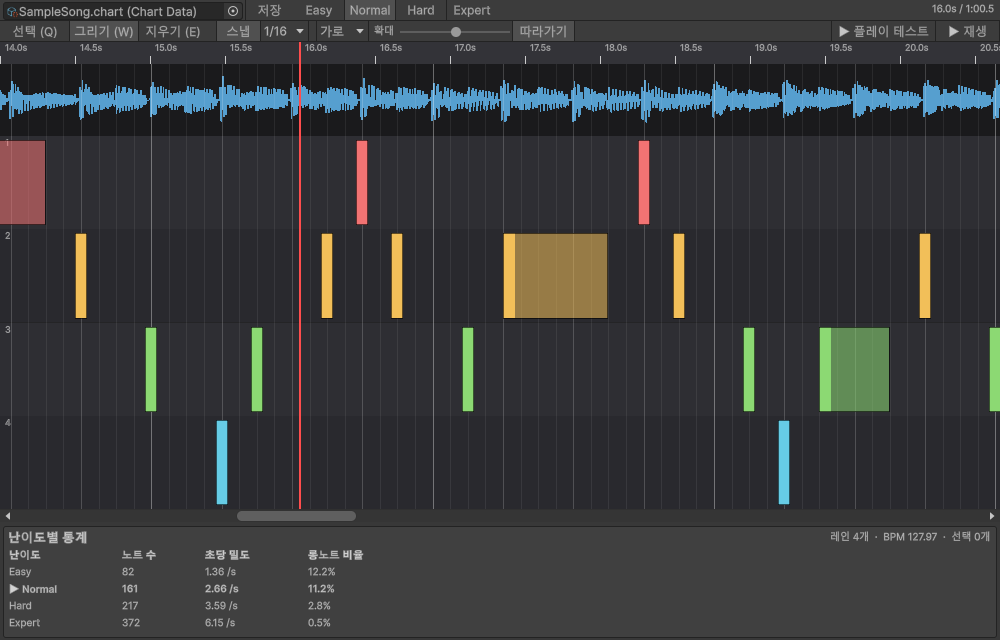
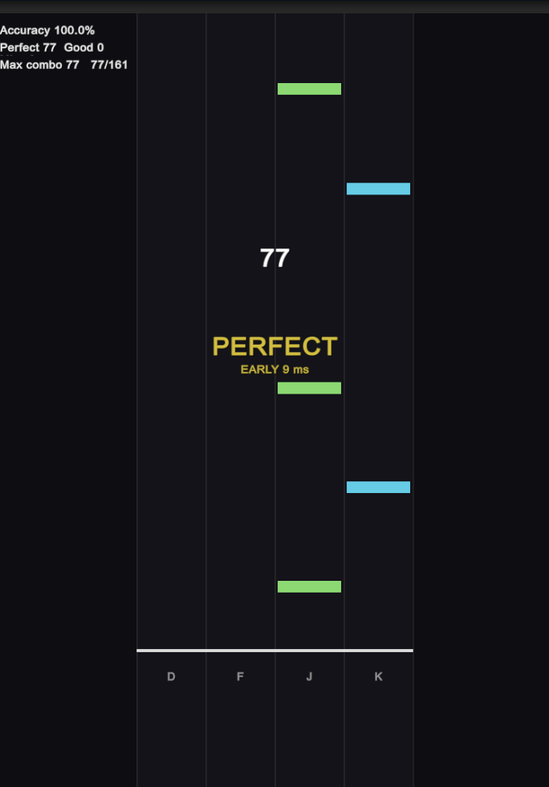

# Rhythm Chart Tool

mp3 를 Python(librosa)으로 분석해 BPM·박자·타격 시점을 뽑고, **난이도 4단계(Easy/Normal/Hard/Expert) 노트를 자동 생성**한 뒤, Unity 에디터 안에서 파형을 보며 고치고 저장하는 **리듬게임 차트 제작 도구(UPM 패키지)** 입니다.



> **상태: 0.1.0 (초기 버전).** Unity 6000.3 + Windows + Python 3.13 에서만 검증했습니다. Unity 2022.3 호환, macOS/Linux, 사람이 직접 쳐 본 체감 검증은 아직 없습니다. 자세한 내용은 [알려진 한계](Packages-src/com.sumin.rhythm-chart-tool/README.md#알려진-한계).

## 설치

Unity **Package Manager → `+` → Add package from git URL...**

```
https://github.com/sum-in2/rhythm-chart-tool.git?path=/Packages-src/com.sumin.rhythm-chart-tool#v0.1.0
```

- `#v0.1.0` 은 Git 태그입니다(태그가 없으면 `#main`).
- 이 저장소는 **비공개**입니다. Unity 가 호출하는 시스템 `git` 에 인증(자격 증명 관리자 또는 SSH)이 되어 있어야 합니다.
- Input System 패키지(`com.unity.inputsystem`)가 의존성으로 함께 설치됩니다.

요구 사항: Unity 6000.3(검증됨, 목표 2022.3+), Python 3.12 이상, 인터넷(처음 한 번 Python 패키지 설치).

## 5분 시작

1. `Tools > Rhythm Chart > Settings...` → **Python 환경 설정**
2. 오디오 선택 → `Tools > Rhythm Chart > Analyze Selected Audio`
3. 생성된 `*.chart.asset` 더블클릭 → **차트 에디터**에서 수정, `▶ 플레이 테스트`로 직접 쳐 보기

설치부터 사용법, 단축키, 난이도 설정, 런타임 API, 문제 해결까지는 **[패키지 README](Packages-src/com.sumin.rhythm-chart-tool/README.md)** 에 있고, JSON 형식은 **[JSON 스키마](Packages-src/com.sumin.rhythm-chart-tool/Documentation~/JsonSchemas.md)** 에 있습니다. 변경 내역은 [CHANGELOG](Packages-src/com.sumin.rhythm-chart-tool/CHANGELOG.md).



## 저장소 구조

```
/
├─ Packages-src/com.sumin.rhythm-chart-tool/   # 패키지 (Runtime, Editor, Python~, Samples~, Documentation~, Tests)
├─ TestProject/                                # 개발·테스트용 Unity 프로젝트 (패키지를 file: 경로로 참조)
├─ TestAudio/                                  # analyze.py 시험용 오디오를 넣는 폴더 (내용은 git 에서 제외)
├─ tools/make_demo_song.py                     # 샘플 데모곡 합성 스크립트
└─ README.md
```

## 개발

- `TestProject` 를 Unity 6000.3 으로 열면 패키지가 로컬로 연결됩니다. `Window > General > Test Runner > EditMode` 에서 `RhythmChart.Tests.Editor` 를 실행합니다(110개).
- Python 스크립트를 직접 시험하려면 저장소 루트에 venv 를 만들고 `Packages-src/com.sumin.rhythm-chart-tool/Python~/requirements.txt` 를 설치한 뒤 `python Packages-src/com.sumin.rhythm-chart-tool/Python~/analyze.py <오디오> <출력.json>` 을 실행합니다. `TestAudio/` 에 넣은 오디오는 커밋되지 않습니다.
- 커밋 메시지는 Conventional Commits 를 따릅니다.

## 저작권 안내

> 분석하는 오디오와 그로 만든 차트의 권리와 이용에 대한 책임은 사용자에게 있습니다. 이용 권한이 있는 음원에만 사용하세요.

## 라이선스

[MIT](Packages-src/com.sumin.rhythm-chart-tool/LICENSE) © 2026 sum-in2
